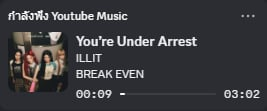
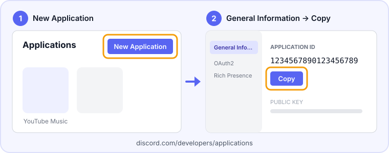
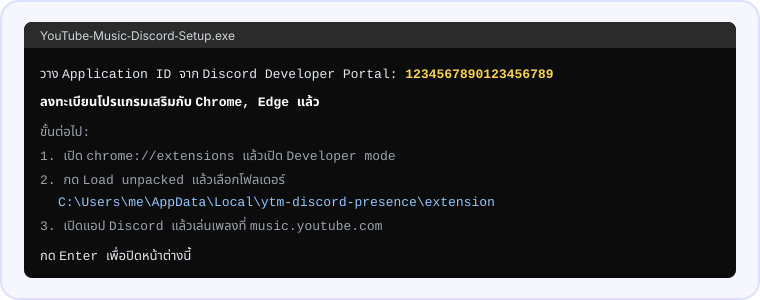
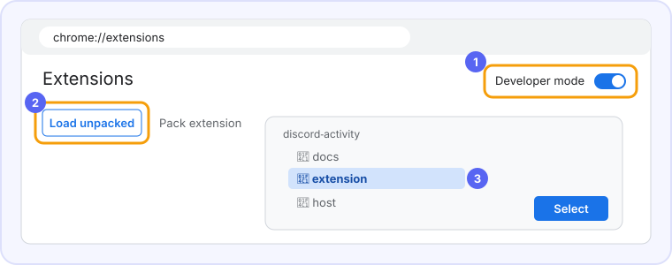
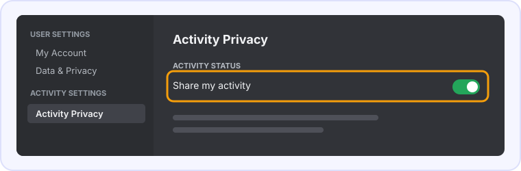

<p align="center"></p>

<h1 align="center">YouTube Music → Discord</h1>

<p align="center">
  <b>Show what you're playing on YouTube Music as your Discord status</b><br>
  For Chrome on Windows and macOS<br>
  <sub><a href="README.md">ภาษาไทย</a> · <b>English</b></sub>
</p>

<p align="center">
  <a href="https://github.com/tobsatop/discord-activity/actions/workflows/ci.yml"></a>
  <a href="LICENSE"></a>
</p>

<p align="center"></p>

- Shows the song, artist, album art, a time bar and a Listen on YouTube Music button
- The status clears by itself when you pause, during ads, or when you close the tab
- Set up once; nothing to keep running

## Before you start

You need **Google Chrome** and the **Discord desktop app** (Discord in a browser won't work).
Works with **music.youtube.com** only, not regular youtube.com.

> The installer and the toolbar tooltips show messages in Thai. The ones you need are translated below.

## Install (once per computer, about 10 minutes)

### 1. Create a Discord Application ID

Once; reuse it on every computer.

1. Go to https://discord.com/developers/applications and log in with your Discord account
2. Click **New Application**, name it `YouTube Music`, accept the terms and click **Create** (the name shows as "Listening to YouTube Music")
3. On **General Information**, click **Copy** next to **Application ID** and keep it for step 3



### 2. Install Node.js and download the project

1. Install **Node.js 24 LTS** from https://nodejs.org (click Next until done; the defaults are fine)
2. On this page, click the green **Code** button, choose **Download ZIP**, then extract it (Windows: right-click → Extract All)
3. Move the folder somewhere permanent, such as Documents (if you move it later, redo step 3)

### 3. Run the installer

**Windows**
1. Open the project folder, right-click an empty area and choose **Open in Terminal** (Windows 10: hold `Shift`, right-click → **Open PowerShell window here**)
2. Type `node scripts\install.ts` and press Enter
3. Paste the Application ID (right-click or `Ctrl + V`) and press Enter

**macOS**
1. Open Chrome once first, then open the **Terminal** app (`Cmd + Space`, type Terminal)
2. Type `cd ` (with a space), drag the project folder into the window and press Enter
3. Type `npm run setup`, press Enter, paste the Application ID (`Cmd + V`) and press Enter

The green line **ลงทะเบียนโปรแกรมเสริมกับ Chrome … แล้ว** ("registered the helper with Chrome …") means it worked.
The question before it, **วาง Application ID จาก Discord Developer Portal**, means "paste the Application ID".



### 4. Add the extension to Chrome

1. Type `chrome://extensions` in the address bar
2. Turn on **Developer mode** at the top right
3. Click **Load unpacked** and choose the **extension** folder inside the project (not the whole project folder)
4. Click the puzzle icon in Chrome's toolbar and pin **YouTube Music → Discord** so you can see its icon



### 5. Turn on activity sharing in Discord and play a song

1. In the Discord app, go to **User Settings → Activity Privacy** and turn on **Share my activity** (the name varies a little between versions, e.g. *Display current activity as a status message*)
2. Open https://music.youtube.com and play a song (if the tab was already open, refresh it once)



### Done

Within a few seconds the extension icon turns **red** and your Discord profile shows "Listening to …".
From now on, just open Discord and play music in Chrome; there is nothing else to install.

## What the icon means

Hover over the icon for details.

| Icon | Meaning |
|---|---|
|  Red | Showing on Discord |
|  Grey | No YouTube Music tab, or nothing playing |
|  Grey + orange dot | Can't find the Discord app on this computer |
|  Grey + red dot | The helper won't start, or Discord rejected the Application ID |

## FAQ

<details>
<summary><b>The icon has a red dot</b></summary>

- **"เปิดโปรแกรมเสริมไม่ได้"** (the helper won't start): step 3 wasn't done, or the folder was moved, or Node was removed. Redo step 3 and wait about 30 seconds
- **"Discord ไม่รับการเชื่อมต่อ … Application ID"** (Discord rejected the connection): the Application ID is wrong; see "Change the Application ID" below
</details>

<details>
<summary><b>The icon has an orange dot ("ยังไม่เจอแอป Discord", Discord not found)</b></summary>

Open the Discord app and wait about 15 seconds. If it stays on Windows, quit a Discord started with Run as administrator and open it normally.
</details>

<details>
<summary><b>The icon is grey while music is playing</b></summary>

Refresh the YouTube Music tab once (needed every time after adding or reloading the extension).
</details>

<details>
<summary><b>The icon is red but friends don't see it</b></summary>

Turn on Share my activity (step 5) and don't set your status to Invisible.
You can't click Listen on YouTube Music on your own profile; that's how Discord works. Others can.
</details>

<details>
<summary><b>The installer shows an error</b></summary>

- **`node is not recognized`**: close and reopen the Terminal, or restart the computer after installing Node
- **`Unknown file extension ".ts"`**: Node is too old; it must be 22.18 or newer. Install Node 24 LTS (check with `node -v`)
- **`running scripts is disabled on this system`** (Windows): use `node scripts\install.ts` instead of `npm run setup`
- **"ไม่พบ Chrome บนเครื่องนี้"** (Chrome not found, macOS): open Chrome once and run it again
- **Load unpacked says `Manifest file is missing`**: choose the `extension` folder inside, not the project folder
- A work or school Chrome profile may have Developer mode turned off by the organisation; try a personal profile
</details>

<details>
<summary><b>Other problems</b></summary>

- The status lags when you skip songs quickly: Discord accepts 5 updates per 20 seconds; it catches up
- To start Discord when the computer starts: on Windows, Discord → User Settings → Windows Settings → Open Discord; on macOS, add Discord in System Settings → General → Login Items
- Still stuck: look at `host/host.log` in the project folder
</details>

<details>
<summary><b>When do I run the installer again?</b></summary>

Not every time you start the computer. Only when you
- move or rename the project folder
- remove or move Node, or update it through nvm or Homebrew (updating with the installer from nodejs.org is fine)
- change the Application ID
</details>

<details>
<summary><b>Change the Application ID</b></summary>

Run the installer with the new ID at the end:
- Windows: `node scripts\install.ts 123456789012345678`
- macOS: `npm run setup -- 123456789012345678`

Then close every YouTube Music tab and open it again.
</details>

<details>
<summary><b>Update to a new version</b></summary>

Your version is shown at `chrome://extensions`; what's new is in [CHANGELOG.md](CHANGELOG.md) (in Thai). Updating keeps your Application ID.

1. Open a Terminal in the project folder (as in step 3) and run
   - Windows: `node scripts\update.ts`
   - macOS: `npm run update`
2. At `chrome://extensions`, click the reload button ↻ on the extension's card
3. Refresh the YouTube Music tab

If you downloaded with git, use `git pull` instead of step 1.

Still on version 0.1.0 (no `scripts/update.ts` yet): download the ZIP again, extract it, copy everything inside over the old folder (choose Replace), then do steps 2 and 3.
</details>

<details>
<summary><b>Uninstall</b></summary>

1. Windows: `node scripts\install.ts --uninstall` · macOS: `npm run setup -- --uninstall`
2. At `chrome://extensions`, click **Remove** on the extension
3. Delete the project folder, and the application in the Discord Developer Portal if you no longer need it
</details>

<details>
<summary><b>Privacy</b></summary>

- The extension runs only on music.youtube.com and asks only for `nativeMessaging` (to talk to the helper on your computer)
- Song details go only to the Discord app on your computer, no other server. Discord shows them to friends according to your settings
- `host/host.log` keeps the latest song titles on your computer for troubleshooting; it clears itself past 1 MB
</details>

## For developers

<details>
<summary>How it works, commands and releasing</summary>

```
music.youtube.com ─▶ Chrome extension ─▶ helper (started by Chrome) ─▶ Discord app
```

| File | What it does |
|---|---|
| `extension/page-reader.js` | Reads the song, artist, art and playback time from the YouTube Music page |
| `extension/bridge.js` | Passes data from the page to the background script |
| `extension/background.js` | Picks the track to show, sends it to the helper and updates the icon |
| `host/main.ts` | The helper Chrome starts (native messaging) |
| `host/discord-ipc.ts` | Talks to the Discord app over IPC, reconnects, and rate-limits as Discord requires |
| `host/activity.ts` | Turns track data into a Discord activity and validates what the browser sends |
| `scripts/install.ts` | Registers the helper with Chrome (Windows / macOS / Linux) |
| `scripts/update.ts` | Updates a ZIP download to the latest version from GitHub |
| `scripts/icons.ts` | Builds every state's PNG from `extension/icons/icon.svg` (needs ImageMagick) |

```
npm install      # only TypeScript and type definitions
npm run check    # type-check both sides
npm test         # test the helper against a fake Discord
```

- Node runs the `.ts` files directly, so there is no build. The extension is plain `.js`, type-checked by TypeScript
- After editing `extension/`, click ↻ at `chrome://extensions` and refresh the YouTube Music tab
- After editing `host/`, close every YouTube Music tab and open it again (the helper restarts)
- Icons: edit `extension/icons/icon.svg` and run `npm run icons` to rebuild every state
- Windows PowerShell: use `npm.cmd` instead of `npm`, e.g. `npm.cmd test`, and quit Discord before running tests, because the fake Discord uses the real pipe name
- On every push, GitHub Actions runs `npm run check` and `npm test` on Windows, macOS and Linux
- Releasing: set the same version in `package.json` and `extension/manifest.json`, add a `CHANGELOG.md` entry, and keep `README.md` (Thai) and `README.en.md` (English) in sync
</details>

## License

[MIT](LICENSE) — use, change and share it, with credit.

YouTube Music is a trademark of Google LLC, and Discord is a trademark of Discord Inc.
This project is not affiliated with or endorsed by either company.
