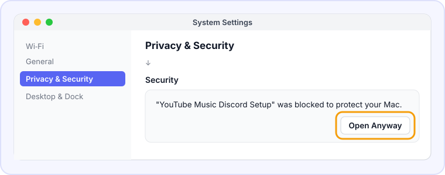

<p align="center"></p>

<h1 align="center">YouTube Music → Discord</h1>

<p align="center">
  <b>Show what you're playing on YouTube Music as your Discord status</b><br>
  For Chrome on Windows and macOS<br>
  <sub><a href="README.md">ภาษาไทย</a> · <b>English</b></sub>
</p>

<p align="center">
  <a href="https://github.com/tobsatop/discord-activity/actions/workflows/ci.yml"></a>
  <a href="LICENSE"></a>
</p>

<p align="center"></p>

- Shows the song, artist, album art, a time bar and a Listen on YouTube Music button
- The status clears by itself when you pause, during ads, or when you close the tab
- Set up once; nothing to keep running and nothing else to install

## Before you start

You need **Google Chrome** and the **Discord desktop app** (Discord in a browser won't work).
Works with **music.youtube.com** only, not regular youtube.com.

> The installer and the toolbar tooltips show messages in Thai. The ones you need are translated below.

## Install (once per computer, about 5 minutes)

### 1. Create a Discord Application ID

Once; reuse it on every computer.

1. Go to https://discord.com/developers/applications and log in with your Discord account
2. Click **New Application**, name it `YouTube Music`, accept the terms and click **Create** (the name shows as "Listening to YouTube Music")
3. On **General Information**, click **Copy** next to **Application ID** and keep it for step 3


### 2. Download the installer

| Computer | File |
|---|---|
| Windows | **[YouTube-Music-Discord-Setup.exe](https://github.com/tobsatop/discord-activity/releases/latest/download/YouTube-Music-Discord-Setup.exe)** (ARM PCs such as Snapdragon: [this file](https://github.com/tobsatop/discord-activity/releases/latest/download/YouTube-Music-Discord-Setup-ARM.exe)) |
| macOS | **[YouTube-Music-Discord-Setup-Mac.zip](https://github.com/tobsatop/discord-activity/releases/latest/download/YouTube-Music-Discord-Setup-Mac.zip)**, then double-click it to get the app **YouTube Music Discord Setup** |

If the browser warns that the file isn't commonly downloaded, choose **Keep** (in Edge it's under the **…** button next to the file).

### 3. Run the installer

1. Double-click the downloaded file. The first time, your computer warns you because the program isn't code-signed
   - **Windows:** click **More info**, then **Run anyway**

     

   - **macOS:** click **Done**, then go to **System Settings → Privacy & Security**, scroll down and click **Open Anyway** (macOS 14 or older: right-click the app and choose **Open**)

     

2. Paste the Application ID when the installer asks for it; the question reads **วาง Application ID จาก Discord Developer Portal** ("paste the Application ID")
   - **Windows:** in the installer window, right-click or press `Ctrl + V`, then press Enter
   - **macOS:** in the dialog box, press `Cmd + V`, then click **ติดตั้ง** ("Install")
3. The line **ลงทะเบียนโปรแกรมเสริมกับ Chrome … แล้ว** ("registered the helper with Chrome …") means it worked (on macOS it appears in a **ติดตั้งเสร็จแล้ว**, "Installed", dialog). The installer then opens a window with the **extension** folder selected


### 4. Add the extension to Chrome

1. Open Chrome, type `chrome://extensions` in the address bar and turn on **Developer mode** at the top right
2. Click **Load unpacked** and choose the **extension** folder the installer opened for you
   - Or drag that **extension** folder onto the `chrome://extensions` page
3. Click the puzzle icon in Chrome's toolbar and pin **YouTube Music → Discord** so you can see its icon


### 5. Turn on activity sharing in Discord and play a song

1. In the Discord app, go to **User Settings → Activity Privacy** and turn on **Share my activity** (the name varies a little between versions, e.g. *Display current activity as a status message*)
2. Open https://music.youtube.com and play a song (if the tab was already open, refresh it once)


### Done

Within a few seconds the extension icon turns **red** and your Discord profile shows "Listening to …".
From now on, just open Discord and play music in Chrome. You can delete the downloaded file.

## What the icon means

Hover over the icon for details.

| Icon | Meaning |
|---|---|
|  Red | Showing on Discord |
|  Grey | No YouTube Music tab, or nothing playing |
|  Grey + orange dot | Can't find the Discord app on this computer |
|  Grey + red dot | The helper won't start, or Discord rejected the Application ID |

## FAQ

<details>
<summary><b>The icon has a red dot</b></summary>

- **"เปิดโปรแกรมเสริมไม่ได้"** (the helper won't start) or **"ยังไม่ได้ใส่ Discord Application ID"** (no Application ID yet): run the installer again (step 3) and wait about 30 seconds
- **"Discord ไม่รับการเชื่อมต่อ … Application ID"** (Discord rejected the connection): the Application ID is wrong; see "Change the Application ID" below
</details>

<details>
<summary><b>The icon has an orange dot ("ยังไม่เจอแอป Discord", Discord not found)</b></summary>

Open the Discord app and wait about 15 seconds. If it stays on Windows, quit a Discord started with Run as administrator and open it normally.
</details>

<details>
<summary><b>The icon is grey while music is playing</b></summary>

Refresh the YouTube Music tab once (needed every time after adding or reloading the extension).
</details>

<details>
<summary><b>The icon is red but friends don't see it</b></summary>

Turn on Share my activity (step 5) and don't set your status to Invisible.
You can't click Listen on YouTube Music on your own profile; that's how Discord works. Others can.
</details>

<details>
<summary><b>The installer won't run</b></summary>

- **Windows shows no Run anyway button:** right-click the file → Properties → tick **Unblock** → OK, then open it again
- **Windows 11 says Smart App Control blocked it:** that mode blocks every unsigned program and can't allow a single file, so this doesn't work on PCs with it turned on yet
- **Windows Security says the file is dangerous:** unsigned programs can get false alarms. Every download is built from this repo's code by GitHub; if you're unsure, don't skip the warning
- **"ไม่พบ Chrome บนเครื่องนี้"** (Chrome not found): install or open Chrome once, then run the installer again
- **Load unpacked says `Manifest file is missing`:** choose the `extension` folder itself, not the folder around it
- **Can't find the extension folder:** it is `%LOCALAPPDATA%\ytm-discord-presence\extension` (Windows) or `~/Library/Application Support/ytm-discord-presence/extension` (macOS: press `Cmd + Shift + G` in the folder picker and paste this path)
- **Thai text in the installer window shows as boxes:** it still works; follow the steps in this README
- A work or school Chrome profile may have Developer mode turned off by the organisation; try a personal profile
</details>

<details>
<summary><b>Other problems</b></summary>

- The status lags when you skip songs quickly: Discord accepts 5 updates per 20 seconds; it catches up
- To start Discord when the computer starts: on Windows, Discord → User Settings → Windows Settings → Open Discord; on macOS, add Discord in System Settings → General → Login Items
- Still stuck: look at `host.log` in the `ytm-discord-presence` folder (same place as the extension folder above)
</details>

<details>
<summary><b>When do I run the installer again?</b></summary>

Not every time you start the computer. Only to update to a new version or to change the Application ID.
</details>

<details>
<summary><b>Change the Application ID</b></summary>

The installer remembers the ID. To change it:
1. Delete `config.json` in the `ytm-discord-presence` folder (see "The installer won't run" above for where it is)
2. Double-click the installer again and paste the new ID
3. Close every YouTube Music tab and open it again
</details>

<details>
<summary><b>Update to a new version</b></summary>

Your version is shown at `chrome://extensions`; what's new is in [CHANGELOG.md](CHANGELOG.md) (in Thai). Updating keeps your Application ID.

1. Download the new installer (step 2) and double-click it
2. At `chrome://extensions`, click the reload button ↻ on the extension's card
3. Refresh the YouTube Music tab

**Updating from 0.2 or older (the version that needed Node.js):**
1. Download the installer and double-click it; it reuses your Application ID
2. At `chrome://extensions`, click **Remove** on the old card, then **Load unpacked** the new folder the installer opens
3. Refresh the YouTube Music tab
4. Delete the old project folder, and uninstall Node.js if you don't use it for anything else
</details>

<details>
<summary><b>Uninstall</b></summary>

1. Quit Chrome
2. Run the uninstall command
   - **Windows:** open a Terminal in the folder with the installer (download it again if you deleted it) and run `.\YouTube-Music-Discord-Setup.exe --uninstall`
   - **macOS:** open the Terminal app and run `"$HOME/Library/Application Support/ytm-discord-presence/ytm-discord-host" --uninstall`
3. Open Chrome, go to `chrome://extensions` and click **Remove** on the extension
4. Delete the application in the Discord Developer Portal if you no longer need it
</details>

<details>
<summary><b>Privacy</b></summary>

- The extension runs only on music.youtube.com and asks only for `nativeMessaging` (to talk to the helper on your computer)
- Song details go only to the Discord app on your computer, no other server. Discord shows them to friends according to your settings
- `host.log` keeps the latest song titles on your computer for troubleshooting; it never stores your Discord user name and clears itself past 1 MB
- All the code is in this repo, and the downloads are built from it by GitHub itself
</details>

## For developers

<details>
<summary>How it works, commands and releasing</summary>

```
music.youtube.com ─▶ Chrome extension ─▶ helper (started by Chrome) ─▶ Discord app
```

| File | What it does |
|---|---|
| `extension/page-reader.js` | Reads the song, artist, art and playback time from the YouTube Music page |
| `extension/bridge.js` | Passes data from the page to the background script |
| `extension/background.js` | Picks the track to show, sends it to the helper and updates the icon |
| `main.go` | One program: the installer (double-click) and the helper (started by Chrome), with the extension folder embedded |
| `internal/helper` | The helper: messages from Chrome, config and host.log |
| `internal/activity` | Turns track data into a Discord activity and validates what the browser sends |
| `internal/discordipc` | Talks to the Discord app over IPC, reconnects, and rate-limits as Discord requires |
| `internal/installer` | Registers the helper with Chrome/Edge and unpacks the extension |

```
go vet ./... && go test ./...   # helper and installer tests (against a fake Discord)
go build -o ytm-discord .       # the file users download
npm run check                   # type-check the extension
npm run icons                   # rebuild every icon state from extension/icons/icon.svg (needs ImageMagick)
```

- Never run the installer against real folders on the machine you use; point the `YTM_DISCORD_*` variables at temp folders (see CLAUDE.md)
- While working on the extension, Load unpacked the repo's `extension/` folder (same ID as the installed one); after edits click ↻ and refresh the tab
- On every push, GitHub Actions tests on Windows, macOS and Linux
- Releasing: set the same version in `version.go`, `package.json` and `extension/manifest.json`, add a `CHANGELOG.md` entry, update both READMEs, then push a tag such as `v0.3.1`; GitHub builds the files and the Release page
</details>

## License

[MIT](LICENSE) — use, change and share it, with credit.

YouTube Music is a trademark of Google LLC, and Discord is a trademark of Discord Inc.
This project is not affiliated with or endorsed by either company.
