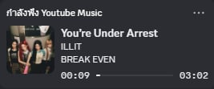
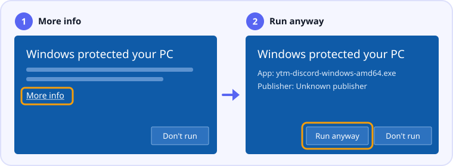
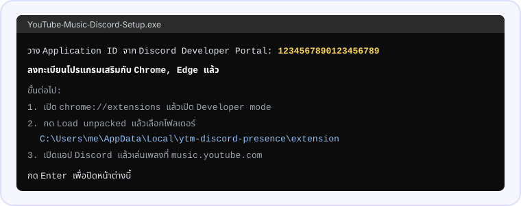

<p align="center"></p>

<h1 align="center">YouTube Music → Discord</h1>

<p align="center">
  <b>โชว์เพลงที่ฟังบน YouTube Music เป็นสถานะใน Discord</b><br>
  ใช้กับ Chrome บน Windows และ macOS<br>
  <sub><b>ภาษาไทย</b> · <a href="README.en.md">English</a></sub>
</p>

<p align="center">
  <a href="https://github.com/tobsatop/discord-activity/actions/workflows/ci.yml"></a>
  <a href="LICENSE"></a>
</p>

<p align="center"></p>

- โชว์ชื่อเพลง ศิลปิน ปกอัลบั้ม แถบเวลา และปุ่ม Listen on YouTube Music
- หยุดเพลง ช่วงโฆษณา หรือปิดแท็บ สถานะหายเอง
- ตั้งครั้งเดียว ไม่ต้องเปิดโปรแกรมค้างไว้ และไม่ต้องลงโปรแกรมอื่นเพิ่ม

## ก่อนเริ่ม

ต้องมี **Google Chrome** และ **แอป Discord** บนคอม (Discord บนเว็บใช้ไม่ได้)
ใช้ได้กับ **music.youtube.com** เท่านั้น ไม่รองรับ youtube.com ธรรมดา

## ติดตั้ง (ครั้งเดียวต่อเครื่อง ประมาณ 5 นาที)

### 1. สร้าง Application ID ใน Discord

ทำครั้งเดียว ใช้ได้ทุกเครื่อง

1. เข้า https://discord.com/developers/applications แล้ว login ด้วยบัญชี Discord
2. กด **New Application** ตั้งชื่อ `YouTube Music` ติ๊กยอมรับ แล้วกด **Create** (ชื่อนี้จะขึ้นเป็น "Listening to YouTube Music")
3. หน้า **General Information** กด **Copy** ที่ **Application ID** เก็บไว้ใช้ในขั้นที่ 3


### 2. ดาวน์โหลดตัวติดตั้ง

| เครื่อง | ไฟล์ |
|---|---|
| Windows | **[ytm-discord-windows-amd64.exe](https://github.com/tobsatop/discord-activity/releases/latest/download/ytm-discord-windows-amd64.exe)** (เครื่องชิป ARM เช่น Snapdragon ใช้ [ไฟล์นี้](https://github.com/tobsatop/discord-activity/releases/latest/download/ytm-discord-windows-arm64.exe)) |
| macOS | **[ytm-discord-macos.zip](https://github.com/tobsatop/discord-activity/releases/latest/download/ytm-discord-macos.zip)** แล้วดับเบิลคลิกแตกไฟล์ จะได้ไฟล์ `ytm-discord` |

ถ้าเบราว์เซอร์เตือนว่าไฟล์ไม่ค่อยมีคนโหลด ให้เลือก **Keep** (ใน Edge อยู่ในปุ่ม **…** ข้างชื่อไฟล์)

### 3. รันตัวติดตั้ง

1. ดับเบิลคลิกไฟล์ที่โหลดมา ครั้งแรกเครื่องจะเตือนเพราะโปรแกรมไม่ได้ซื้อใบรับรอง
   - **Windows:** กด **More info** แล้วกด **Run anyway**

     

   - **macOS:** กด **Done** แล้วไปที่ **System Settings → Privacy & Security** เลื่อนลงแล้วกด **Open Anyway** (macOS 14 หรือเก่ากว่า: คลิกขวาที่ไฟล์แล้วเลือก **Open**)

     

2. หน้าต่างตัวติดตั้งจะถาม Application ID ให้วาง (Windows: คลิกขวา หรือ `Ctrl + V` / macOS: `Cmd + V`) แล้วกด Enter
3. ขึ้นข้อความสีเขียว **ลงทะเบียนโปรแกรมเสริมกับ Chrome … แล้ว** แปลว่าสำเร็จ ตัวติดตั้งจะเปิดโฟลเดอร์ส่วนขยายและหน้า Chrome ให้เอง



### 4. เพิ่มส่วนขยายใน Chrome

1. ที่หน้า `chrome://extensions` เปิด **Developer mode** มุมขวาบน
2. กด **Load unpacked** แล้วเลือกโฟลเดอร์ **extension** ที่ตัวติดตั้งเปิดไว้ให้
   - หรือลากโฟลเดอร์ **extension** จากหน้าต่างนั้นมาวางในหน้า `chrome://extensions` ก็ได้
3. กดรูปจิ๊กซอว์บนแถบ Chrome แล้วปักหมุด **YouTube Music → Discord** ให้เห็นไอคอน


### 5. เปิดการแชร์กิจกรรมใน Discord แล้วลองเล่นเพลง

1. ในแอป Discord ไปที่ **User Settings → Activity Privacy** แล้วเปิด **Share my activity** (ชื่ออาจต่างเล็กน้อยตามเวอร์ชัน เช่น *Display current activity as a status message*)
2. เปิด https://music.youtube.com แล้วเล่นเพลง (ถ้าเปิดแท็บไว้ก่อนแล้ว ให้ refresh หนึ่งครั้ง)


### เสร็จแล้ว

ภายในไม่กี่วินาที ไอคอนส่วนขยายจะเป็น **สีแดง** และโปรไฟล์ Discord ขึ้น "Listening to …"
ครั้งต่อไปแค่เปิด Discord แล้วเล่นเพลงใน Chrome ไม่ต้องติดตั้งอะไรอีก ไฟล์ที่โหลดมาลบทิ้งได้

## ไอคอนบอกอะไร

ชี้เมาส์ค้างที่ไอคอนเพื่อดูรายละเอียด

| ไอคอน | ความหมาย |
|---|---|
|  สีแดง | กำลังโชว์ใน Discord |
|  สีเทา | ยังไม่มีแท็บ YouTube Music หรือยังไม่ได้เล่นเพลง |
|  เทา + จุดส้ม | ไม่เจอแอป Discord บนเครื่อง |
|  เทา + จุดแดง | เปิดโปรแกรมเสริมไม่ได้ หรือ Discord ไม่รับ Application ID |

## คำถามที่พบบ่อย

<details>
<summary><b>ไอคอนมีจุดแดง</b></summary>

- **"เปิดโปรแกรมเสริมไม่ได้"** หรือ **"ยังไม่ได้ใส่ Discord Application ID"**: รันตัวติดตั้งอีกครั้ง (ขั้นที่ 3) แล้วรอประมาณ 30 วินาที
- **"Discord ไม่รับการเชื่อมต่อ … Application ID"**: Application ID ผิด ดูหัวข้อ "เปลี่ยน Application ID" ด้านล่าง
</details>

<details>
<summary><b>ไอคอนมีจุดส้ม "ยังไม่เจอแอป Discord"</b></summary>

เปิดแอป Discord แล้วรอประมาณ 15 วินาที ถ้ายังไม่หายบน Windows ให้ปิด Discord ที่เปิดแบบ Run as administrator แล้วเปิดใหม่แบบปกติ
</details>

<details>
<summary><b>ไอคอนสีเทาทั้งที่เล่นเพลงอยู่</b></summary>

refresh แท็บ YouTube Music หนึ่งครั้ง (ต้องทำทุกครั้งหลังเพิ่มหรือ reload ส่วนขยาย)
</details>

<details>
<summary><b>ไอคอนสีแดงแต่เพื่อนไม่เห็น</b></summary>

เปิด Share my activity ตามขั้นที่ 5 และอย่าตั้งสถานะเป็น Invisible
ปุ่ม Listen on YouTube Music บนโปรไฟล์ตัวเองจะกดไม่ได้ เป็นปกติของ Discord คนอื่นกดได้
</details>

<details>
<summary><b>ติดตั้งไม่ได้</b></summary>

- **Windows ไม่มีปุ่ม Run anyway:** คลิกขวาที่ไฟล์ → Properties → ติ๊ก **Unblock** → OK แล้วเปิดใหม่
- **"ไม่พบ Chrome บนเครื่องนี้":** ติดตั้งหรือเปิด Chrome หนึ่งครั้ง แล้วรันตัวติดตั้งใหม่
- **Load unpacked ขึ้น `Manifest file is missing`:** เลือกโฟลเดอร์ `extension` ข้างใน ไม่ใช่โฟลเดอร์ที่ครอบอยู่
- **หาโฟลเดอร์ส่วนขยายไม่เจอ:** อยู่ที่ `%LOCALAPPDATA%\ytm-discord-presence\extension` (Windows) หรือ `~/Library/Application Support/ytm-discord-presence/extension` (macOS กด `Cmd + Shift + G` ในหน้าต่างเลือกโฟลเดอร์แล้ววางที่อยู่นี้)
- **ตัวหนังสือไทยในหน้าต่างตัวติดตั้งเป็นกล่องสี่เหลี่ยม:** ยังใช้ได้ตามปกติ ทำตามขั้นตอนใน README ได้เลย
- ใช้ Chrome โปรไฟล์ที่ทำงานหรือโรงเรียนดูแล: องค์กรอาจปิด Developer mode ไว้ ลองโปรไฟล์ส่วนตัว
</details>

<details>
<summary><b>อาการอื่น ๆ</b></summary>

- สถานะเปลี่ยนช้าเมื่อกดข้ามเพลงรัว ๆ: Discord รับได้ 5 ครั้งต่อ 20 วินาที เดี๋ยวตามมาเอง
- ให้ Discord เปิดเองตอนเปิดเครื่อง: Windows ตั้งใน Discord → User Settings → Windows Settings → Open Discord, macOS เพิ่ม Discord ใน System Settings → General → Login Items
- ยังไม่หาย: ดู log ที่ `host.log` ในโฟลเดอร์ `ytm-discord-presence` (ที่อยู่เดียวกับโฟลเดอร์ส่วนขยายด้านบน)
</details>

<details>
<summary><b>ต้องรันตัวติดตั้งใหม่เมื่อไหร่</b></summary>

ไม่ต้องรันทุกครั้งที่เปิดเครื่อง รันใหม่เฉพาะเมื่ออัปเดตเป็นเวอร์ชันใหม่ หรือเปลี่ยน Application ID
</details>

<details>
<summary><b>เปลี่ยน Application ID</b></summary>

ตัวติดตั้งจำ ID เดิมไว้ ถ้าจะเปลี่ยน:
1. ลบไฟล์ `config.json` ในโฟลเดอร์ `ytm-discord-presence` (ที่อยู่ดูในหัวข้อ "ติดตั้งไม่ได้" ด้านบน)
2. ดับเบิลคลิกตัวติดตั้งอีกครั้ง แล้ววาง ID ใหม่
3. ปิดแท็บ YouTube Music ทุกแท็บแล้วเปิดใหม่
</details>

<details>
<summary><b>อัปเดตเป็นเวอร์ชันใหม่</b></summary>

ดูเวอร์ชันที่ใช้อยู่ได้ที่ `chrome://extensions` และดูว่ามีอะไรใหม่ใน [CHANGELOG.md](CHANGELOG.md) อัปเดตแล้ว Application ID ไม่หาย

1. โหลดตัวติดตั้งตัวใหม่ (ขั้นที่ 2) แล้วดับเบิลคลิก
2. ไปที่ `chrome://extensions` แล้วกดปุ่มหมุน ↻ บนการ์ดของส่วนขยาย
3. refresh แท็บ YouTube Music

**อัปเดตจากเวอร์ชัน 0.2 หรือเก่ากว่า (แบบที่ต้องลง Node.js):**
1. โหลดตัวติดตั้งแล้วดับเบิลคลิก ใช้ Application ID เดิมให้เอง
2. ที่ `chrome://extensions` กด **Remove** การ์ดเดิม แล้วกด **Load unpacked** เลือกโฟลเดอร์ใหม่ที่ตัวติดตั้งเปิดให้
3. refresh แท็บ YouTube Music
4. ลบโฟลเดอร์โปรเจกต์เดิมได้เลย และถอน Node.js ได้ถ้าไม่ได้ใช้ทำอย่างอื่น
</details>

<details>
<summary><b>ถอนการติดตั้ง</b></summary>

1. ปิด Chrome
2. เปิด Terminal ในโฟลเดอร์ที่มีตัวติดตั้ง (ถ้าลบไปแล้ว โหลดใหม่ได้) แล้วรัน
   - Windows: `.\ytm-discord-windows-amd64.exe --uninstall`
   - macOS: `./ytm-discord --uninstall`
3. เปิด Chrome ไปที่ `chrome://extensions` แล้วกด **Remove** ส่วนขยาย
4. ลบ Application ใน Discord Developer Portal ได้ถ้าไม่ใช้แล้ว
</details>

<details>
<summary><b>ความเป็นส่วนตัว</b></summary>

- ส่วนขยายทำงานเฉพาะบน music.youtube.com และขอสิทธิ์แค่ `nativeMessaging` (คุยกับโปรแกรมเสริมบนเครื่อง)
- ข้อมูลเพลงส่งไปแค่แอป Discord บนเครื่องคุณ ไม่มีเซิร์ฟเวอร์อื่น Discord จะโชว์ให้เพื่อนเห็นตามการตั้งค่าของคุณ
- `host.log` เก็บชื่อเพลงล่าสุดไว้บนเครื่องเพื่อใช้แก้ปัญหา ไม่เก็บชื่อผู้ใช้ Discord และเกิน 1 MB จะล้างเอง
- โค้ดทั้งหมดเปิดให้ดูได้ใน repo นี้ และไฟล์ดาวน์โหลดสร้างจากโค้ดนี้โดย GitHub เอง
</details>

## สำหรับนักพัฒนา

<details>
<summary>ทำงานยังไง, คำสั่ง, และการออกเวอร์ชัน</summary>

```
music.youtube.com ─▶ ส่วนขยาย Chrome ─▶ โปรแกรมเสริม (Chrome เปิดให้เอง) ─▶ แอป Discord
```

| ไฟล์ | หน้าที่ |
|---|---|
| `extension/page-reader.js` | อ่านเพลง ศิลปิน ปก และเวลาที่เล่นจากหน้า YouTube Music |
| `extension/bridge.js` | ส่งต่อข้อมูลจากหน้าเว็บไปที่ background |
| `extension/background.js` | เลือกเพลงที่จะโชว์ ส่งให้โปรแกรมเสริม และอัปเดตไอคอน |
| `main.go` | โปรแกรมเดียว: ตัวติดตั้ง (ดับเบิลคลิก) และโปรแกรมเสริม (Chrome เปิด) ฝังโฟลเดอร์ส่วนขยายไว้ข้างใน |
| `internal/helper` | โปรแกรมเสริม: รับข้อความจาก Chrome, config และ host.log |
| `internal/activity` | แปลงข้อมูลเพลงเป็นสถานะ Discord และตรวจข้อมูลจากเบราว์เซอร์ |
| `internal/discordipc` | คุยกับแอป Discord ผ่าน IPC ต่อใหม่เองเมื่อหลุด และจำกัดความถี่ตามที่ Discord กำหนด |
| `internal/installer` | ลงทะเบียนโปรแกรมเสริมกับ Chrome/Edge และแตกส่วนขยาย |

```
go vet ./... && go test ./...   # ทดสอบโปรแกรมเสริมและตัวติดตั้ง (กับ Discord จำลอง)
go build -o ytm-discord .       # สร้างไฟล์ที่คนโหลดไปใช้
npm run check                   # ตรวจ type ของส่วนขยาย
npm run icons                   # สร้างไอคอนทุกสถานะจาก extension/icons/icon.svg (ต้องมี ImageMagick)
```

- ห้ามรันตัวติดตั้งกับโฟลเดอร์จริงบนเครื่องที่ใช้งาน ใช้ตัวแปร `YTM_DISCORD_*` ชี้ไปโฟลเดอร์ชั่วคราว (ดู CLAUDE.md)
- ระหว่างแก้ส่วนขยาย กด Load unpacked ที่โฟลเดอร์ `extension/` ใน repo ได้เลย (ID เดียวกับตัวที่ติดตั้ง) แก้แล้วกด ↻ และ refresh แท็บ
- ทุกครั้งที่ push GitHub Actions จะทดสอบบน Windows, macOS และ Linux
- ออกเวอร์ชันใหม่: เปลี่ยนเลขใน `version.go`, `package.json` และ `extension/manifest.json` ให้ตรงกัน เขียนใน `CHANGELOG.md` แก้ README ทั้งสองภาษา แล้ว push tag เช่น `v0.3.1` GitHub จะสร้างไฟล์และหน้า Release ให้เอง
</details>

## License

[MIT](LICENSE) — ใช้ แก้ และแจกต่อได้ โดยใส่เครดิต

YouTube Music เป็นเครื่องหมายการค้าของ Google LLC และ Discord เป็นเครื่องหมายการค้าของ Discord Inc.
โปรเจกต์นี้ไม่ได้เกี่ยวข้อง หรือได้รับการรับรองจากทั้งสองบริษัท
