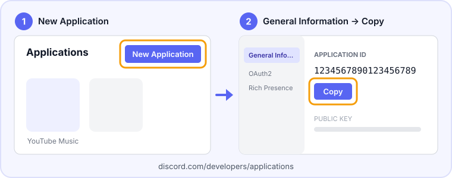
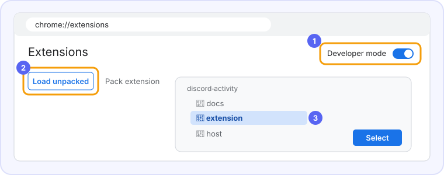
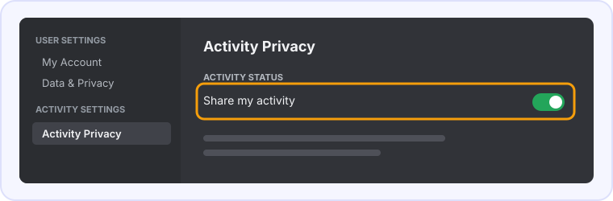

<p align="center"></p>

<h1 align="center">YouTube Music → Discord</h1>

<p align="center">
  <b>โชว์เพลงที่ฟังบน YouTube Music เป็นสถานะใน Discord</b><br>
  ใช้กับ Chrome บน Windows และ macOS<br>
  <sub><b>ภาษาไทย</b> · <a href="README.en.md">English</a></sub>
</p>

<p align="center">
  <a href="https://github.com/tobsatop/discord-activity/actions/workflows/ci.yml"></a>
  <a href="LICENSE"></a>
</p>

<p align="center"></p>

- โชว์ชื่อเพลง ศิลปิน ปกอัลบั้ม แถบเวลา และปุ่ม Listen on YouTube Music
- หยุดเพลง ช่วงโฆษณา หรือปิดแท็บ สถานะหายเอง
- ตั้งครั้งเดียว ไม่ต้องเปิดโปรแกรมค้างไว้

## ก่อนเริ่ม

ต้องมี **Google Chrome** และ **แอป Discord** บนคอม (Discord บนเว็บใช้ไม่ได้)
ใช้ได้กับ **music.youtube.com** เท่านั้น ไม่รองรับ youtube.com ธรรมดา

## ติดตั้ง (ครั้งเดียวต่อเครื่อง ประมาณ 10 นาที)

### 1. สร้าง Application ID ใน Discord

ทำครั้งเดียว ใช้ได้ทุกเครื่อง

1. เข้า https://discord.com/developers/applications แล้ว login ด้วยบัญชี Discord
2. กด **New Application** ตั้งชื่อ `YouTube Music` ติ๊กยอมรับ แล้วกด **Create** (ชื่อนี้จะขึ้นเป็น "Listening to YouTube Music")
3. หน้า **General Information** กด **Copy** ที่ **Application ID** เก็บไว้ใช้ในขั้นที่ 3



### 2. ติดตั้ง Node.js และดาวน์โหลดโปรเจกต์

1. ติดตั้ง **Node.js 24 LTS** จาก https://nodejs.org (กด Next ไปจนจบ ใช้ค่าเริ่มต้นได้เลย)
2. หน้านี้กดปุ่มสีเขียว **Code** แล้วเลือก **Download ZIP** จากนั้นแตกไฟล์ (Windows: คลิกขวา → Extract All)
3. ย้ายโฟลเดอร์ที่ได้ไปไว้ที่ถาวร เช่น Documents (ถ้าย้ายทีหลังต้องทำขั้นที่ 3 ใหม่)

### 3. รันตัวติดตั้ง

**Windows**
1. เปิดโฟลเดอร์โปรเจกต์ คลิกขวาที่ที่ว่าง แล้วเลือก **Open in Terminal** (Windows 10: กด `Shift` ค้างแล้วคลิกขวา → **Open PowerShell window here**)
2. พิมพ์ `node scripts\install.ts` แล้วกด Enter
3. วาง Application ID (คลิกขวา หรือ `Ctrl + V`) แล้วกด Enter

**macOS**
1. เปิด Chrome หนึ่งครั้งก่อน แล้วเปิดแอป **Terminal** (กด `Cmd + Space` พิมพ์ Terminal)
2. พิมพ์ `cd ` (มีเว้นวรรค) แล้วลากโฟลเดอร์โปรเจกต์มาวางในหน้าต่าง กด Enter
3. พิมพ์ `npm run setup` กด Enter แล้ววาง Application ID (`Cmd + V`) กด Enter

ขึ้นข้อความสีเขียว **ลงทะเบียนโปรแกรมเสริมกับ Chrome … แล้ว** แปลว่าสำเร็จ


### 4. เพิ่มส่วนขยายใน Chrome

1. พิมพ์ `chrome://extensions` ในช่อง address
2. เปิด **Developer mode** มุมขวาบน
3. กด **Load unpacked** แล้วเลือกโฟลเดอร์ **extension** ที่อยู่ในโปรเจกต์ (ไม่ใช่โฟลเดอร์โปรเจกต์ทั้งก้อน)
4. กดรูปจิ๊กซอว์บนแถบ Chrome แล้วปักหมุด **YouTube Music → Discord** ให้เห็นไอคอน



### 5. เปิดการแชร์กิจกรรมใน Discord แล้วลองเล่นเพลง

1. ในแอป Discord ไปที่ **User Settings → Activity Privacy** แล้วเปิด **Share my activity** (ชื่ออาจต่างเล็กน้อยตามเวอร์ชัน เช่น *Display current activity as a status message*)
2. เปิด https://music.youtube.com แล้วเล่นเพลง (ถ้าเปิดแท็บไว้ก่อนแล้ว ให้ refresh หนึ่งครั้ง)



### เสร็จแล้ว

ภายในไม่กี่วินาที ไอคอนส่วนขยายจะเป็น **สีแดง** และโปรไฟล์ Discord ขึ้น "Listening to …"
ครั้งต่อไปแค่เปิด Discord แล้วเล่นเพลงใน Chrome ไม่ต้องติดตั้งอะไรอีก

## ไอคอนบอกอะไร

ชี้เมาส์ค้างที่ไอคอนเพื่อดูรายละเอียด

| ไอคอน | ความหมาย |
|---|---|
|  สีแดง | กำลังโชว์ใน Discord |
|  สีเทา | ยังไม่มีแท็บ YouTube Music หรือยังไม่ได้เล่นเพลง |
|  เทา + จุดส้ม | ไม่เจอแอป Discord บนเครื่อง |
|  เทา + จุดแดง | เปิดโปรแกรมเสริมไม่ได้ หรือ Discord ไม่รับ Application ID |

## คำถามที่พบบ่อย

<details>
<summary><b>ไอคอนมีจุดแดง</b></summary>

- **"เปิดโปรแกรมเสริมไม่ได้"**: ยังไม่ได้ทำขั้นที่ 3 ย้ายโฟลเดอร์ไป หรือลบ Node ไป ให้ทำขั้นที่ 3 ใหม่ แล้วรอประมาณ 30 วินาที
- **"Discord ไม่รับการเชื่อมต่อ … Application ID"**: Application ID ผิด ดูหัวข้อ "เปลี่ยน Application ID" ด้านล่าง
</details>

<details>
<summary><b>ไอคอนมีจุดส้ม "ยังไม่เจอแอป Discord"</b></summary>

เปิดแอป Discord แล้วรอประมาณ 15 วินาที ถ้ายังไม่หายบน Windows ให้ปิด Discord ที่เปิดแบบ Run as administrator แล้วเปิดใหม่แบบปกติ
</details>

<details>
<summary><b>ไอคอนสีเทาทั้งที่เล่นเพลงอยู่</b></summary>

refresh แท็บ YouTube Music หนึ่งครั้ง (ต้องทำทุกครั้งหลังเพิ่มหรือ reload ส่วนขยาย)
</details>

<details>
<summary><b>ไอคอนสีแดงแต่เพื่อนไม่เห็น</b></summary>

เปิด Share my activity ตามขั้นที่ 5 และอย่าตั้งสถานะเป็น Invisible
ปุ่ม Listen on YouTube Music บนโปรไฟล์ตัวเองจะกดไม่ได้ เป็นปกติของ Discord คนอื่นกดได้
</details>

<details>
<summary><b>ตัวติดตั้งขึ้น error</b></summary>

- **`node is not recognized`**: ปิดแล้วเปิด Terminal ใหม่ หรือ restart เครื่องหลังติดตั้ง Node
- **`Unknown file extension ".ts"`**: Node เก่าเกินไป ต้องเป็น 22.18 ขึ้นไป ติดตั้ง Node 24 LTS ใหม่ (เช็กด้วย `node -v`)
- **`running scripts is disabled on this system`** (Windows): ใช้ `node scripts\install.ts` แทน `npm run setup`
- **"ไม่พบ Chrome บนเครื่องนี้"** (macOS): เปิด Chrome หนึ่งครั้งแล้วรันใหม่
- **Load unpacked ขึ้น `Manifest file is missing`**: เลือกโฟลเดอร์ `extension` ข้างใน ไม่ใช่โฟลเดอร์โปรเจกต์
- ใช้ Chrome โปรไฟล์ที่ทำงานหรือโรงเรียนดูแล: องค์กรอาจปิด Developer mode ไว้ ลองโปรไฟล์ส่วนตัว
</details>

<details>
<summary><b>อาการอื่น ๆ</b></summary>

- สถานะเปลี่ยนช้าเมื่อกดข้ามเพลงรัว ๆ: Discord รับได้ 5 ครั้งต่อ 20 วินาที เดี๋ยวตามมาเอง
- ให้ Discord เปิดเองตอนเปิดเครื่อง: Windows ตั้งใน Discord → User Settings → Windows Settings → Open Discord, macOS เพิ่ม Discord ใน System Settings → General → Login Items
- ยังไม่หาย: ดู log ที่ `host/host.log` ในโฟลเดอร์โปรเจกต์
</details>

<details>
<summary><b>ต้องรันตัวติดตั้งใหม่เมื่อไหร่</b></summary>

ไม่ต้องรันทุกครั้งที่เปิดเครื่อง รันใหม่เฉพาะเมื่อ
- ย้ายหรือเปลี่ยนชื่อโฟลเดอร์โปรเจกต์
- ลบหรือย้าย Node หรืออัปเดต Node ผ่าน nvm หรือ Homebrew (อัปเดตด้วยไฟล์จาก nodejs.org ไม่ต้องรันใหม่)
- เปลี่ยน Application ID
</details>

<details>
<summary><b>เปลี่ยน Application ID</b></summary>

รันตัวติดตั้งโดยใส่ ID ใหม่ต่อท้าย
- Windows: `node scripts\install.ts 123456789012345678`
- macOS: `npm run setup -- 123456789012345678`

จากนั้นปิดแท็บ YouTube Music ทุกแท็บแล้วเปิดใหม่
</details>

<details>
<summary><b>อัปเดตเป็นเวอร์ชันใหม่</b></summary>

ดูเวอร์ชันที่ใช้อยู่ได้ที่ `chrome://extensions` และดูว่ามีอะไรใหม่ใน [CHANGELOG.md](CHANGELOG.md) อัปเดตแล้ว Application ID ไม่หาย

1. เปิด Terminal ในโฟลเดอร์โปรเจกต์ (แบบขั้นที่ 3) แล้วรัน
   - Windows: `node scripts\update.ts`
   - macOS: `npm run update`
2. ไปที่ `chrome://extensions` แล้วกดปุ่มหมุน ↻ บนการ์ดของส่วนขยาย
3. refresh แท็บ YouTube Music

ถ้าโหลดด้วย git ให้ใช้ `git pull` แทนข้อ 1

ถ้ายังใช้เวอร์ชัน 0.1.0 (ยังไม่มี `scripts/update.ts`): โหลด ZIP ใหม่ แตกไฟล์ แล้ว copy ทุกอย่างข้างในไปวางทับโฟลเดอร์เดิม (เลือก Replace) จากนั้นทำข้อ 2 และ 3
</details>

<details>
<summary><b>ถอนการติดตั้ง</b></summary>

1. Windows: `node scripts\install.ts --uninstall` · macOS: `npm run setup -- --uninstall`
2. ไปที่ `chrome://extensions` แล้วกด **Remove** ส่วนขยาย
3. ลบโฟลเดอร์โปรเจกต์ และลบ Application ใน Discord Developer Portal ได้ถ้าไม่ใช้แล้ว
</details>

<details>
<summary><b>ความเป็นส่วนตัว</b></summary>

- ส่วนขยายทำงานเฉพาะบน music.youtube.com และขอสิทธิ์แค่ `nativeMessaging` (คุยกับโปรแกรมเสริมบนเครื่อง)
- ข้อมูลเพลงส่งไปแค่แอป Discord บนเครื่องคุณ ไม่มีเซิร์ฟเวอร์อื่น Discord จะโชว์ให้เพื่อนเห็นตามการตั้งค่าของคุณ
- `host/host.log` เก็บชื่อเพลงล่าสุดไว้บนเครื่องเพื่อใช้แก้ปัญหา เกิน 1 MB จะล้างเอง
</details>

## สำหรับนักพัฒนา

<details>
<summary>ทำงานยังไง, คำสั่ง, และการออกเวอร์ชัน</summary>

```
music.youtube.com ─▶ ส่วนขยาย Chrome ─▶ โปรแกรมเสริม (Chrome เปิดให้เอง) ─▶ แอป Discord
```

| ไฟล์ | หน้าที่ |
|---|---|
| `extension/page-reader.js` | อ่านเพลง ศิลปิน ปก และเวลาที่เล่นจากหน้า YouTube Music |
| `extension/bridge.js` | ส่งต่อข้อมูลจากหน้าเว็บไปที่ background |
| `extension/background.js` | เลือกเพลงที่จะโชว์ ส่งให้โปรแกรมเสริม และอัปเดตไอคอน |
| `host/main.ts` | โปรแกรมเสริมที่ Chrome เปิดให้เอง (native messaging) |
| `host/discord-ipc.ts` | คุยกับแอป Discord ผ่าน IPC ต่อใหม่เองเมื่อหลุด และจำกัดความถี่ตามที่ Discord กำหนด |
| `host/activity.ts` | แปลงข้อมูลเพลงเป็นสถานะ Discord และตรวจข้อมูลที่ได้จากเบราว์เซอร์ |
| `scripts/install.ts` | ลงทะเบียนโปรแกรมเสริมกับ Chrome (Windows / macOS / Linux) |
| `scripts/update.ts` | อัปเดตโฟลเดอร์ที่โหลดแบบ ZIP เป็นเวอร์ชันล่าสุดจาก GitHub |
| `scripts/icons.ts` | สร้าง PNG ทุกสถานะจาก `extension/icons/icon.svg` (ต้องมี ImageMagick) |

```
npm install      # ติดตั้งแค่ TypeScript กับ type definitions
npm run check    # ตรวจ type ทั้งสองฝั่ง
npm test         # ทดสอบโปรแกรมเสริมกับ Discord จำลอง
```

- Node รันไฟล์ `.ts` ได้ตรง ๆ จึงไม่ต้อง build ส่วนขยายเขียนเป็น `.js` แต่ TypeScript ตรวจ type ให้
- แก้ `extension/` แล้วกด ↻ ที่ `chrome://extensions` และ refresh แท็บ YouTube Music
- แก้ `host/` แล้วปิดแท็บ YouTube Music ทุกแท็บแล้วเปิดใหม่ (โปรแกรมเสริมจะเริ่มใหม่)
- ไอคอน: แก้ `extension/icons/icon.svg` แล้วรัน `npm run icons` จะได้ไอคอนทุกสถานะ
- Windows PowerShell: ใช้ `npm.cmd` แทน `npm` เช่น `npm.cmd test` และปิดแอป Discord ก่อนรันเทสต์ เพราะ Discord จำลองใช้ pipe ชื่อเดียวกับของจริง
- ทุกครั้งที่ push GitHub Actions จะรัน `npm run check` และ `npm test` บน Windows, macOS และ Linux
- ออกเวอร์ชันใหม่: เปลี่ยนเลขใน `package.json` และ `extension/manifest.json` ให้ตรงกัน เขียนใน `CHANGELOG.md` และแก้ README ให้ตรงกันทั้งสองภาษา
</details>

## License

[MIT](LICENSE) — ใช้ แก้ และแจกต่อได้ โดยใส่เครดิต

YouTube Music เป็นเครื่องหมายการค้าของ Google LLC และ Discord เป็นเครื่องหมายการค้าของ Discord Inc.
โปรเจกต์นี้ไม่ได้เกี่ยวข้อง หรือได้รับการรับรองจากทั้งสองบริษัท
